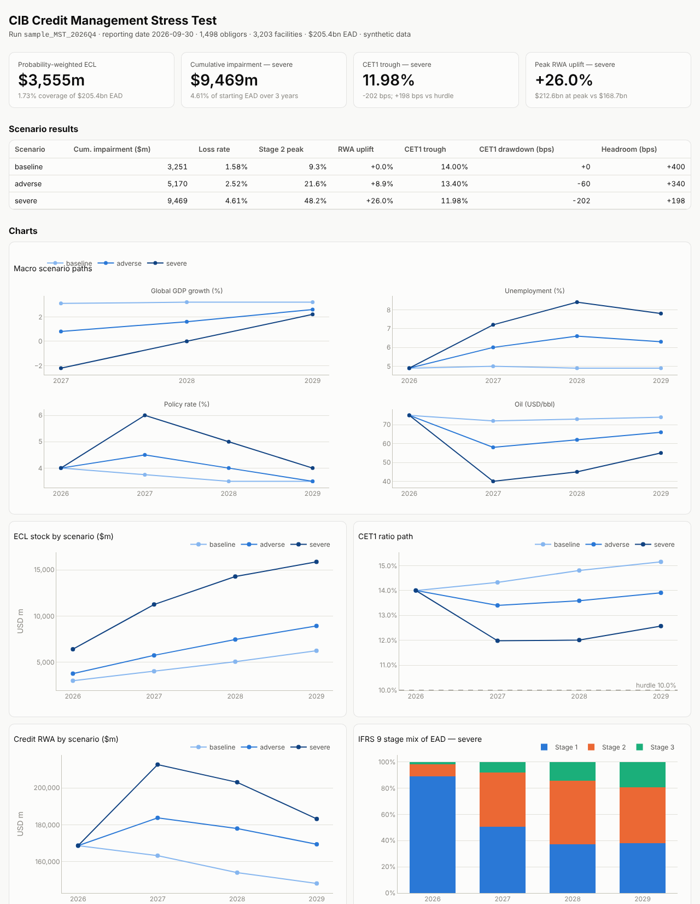
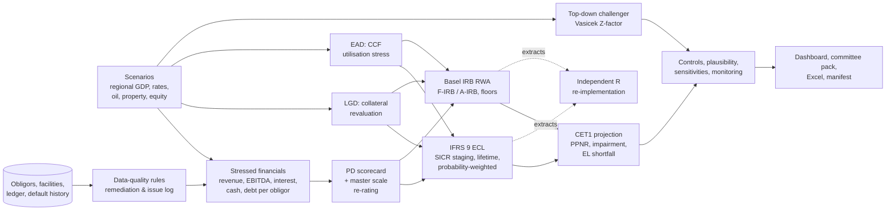

# CIB Credit Management Stress Testing Engine

[](https://github.com/ChandrashekharB91/cib-credit-stress-testing/actions/workflows/ci.yml)

An end-to-end **Management Stress Test (MST)** for a Corporate & Institutional Banking (wholesale) loan book: macro scenarios → **stressed obligor financials** → re-rated **PD**, collateral-sensitive **LGD**, stressed **EAD** → **IFRS 9 ECL** (staging, lifetime, probability-weighted), **Basel IRB RWA** and **CET1** impact — wrapped in the controls a bank needs to run it in production: data-quality rules, reconciliations, plausibility checks, a top-down challenger, sensitivity analysis, model monitoring, a **UAT / UVT pack with an independent R re-implementation**, an audit-trailed run manifest and an auto-generated **committee pack**.

> All data are **synthetic and seeded**. The generator embeds a known "true" credit model so that every component can be tested against ground truth. Results illustrate the methodology and are not representative of any institution.



## Headline results (committed sample run)

| Scenario | Cum. impairment (3y) | Loss rate | Stage 2 peak | Peak RWA uplift | CET1 trough | CET1 drawdown |
|---|---|---|---|---|---|---|
| Baseline | $3.3bn | 1.58% | 9.3% | 0.0% | 14.00% | 0 bps |
| Adverse — trade fragmentation | $5.2bn | 2.52% | 21.6% | +8.9% | 13.40% | −60 bps |
| Severe — Asia-led downturn, commodity collapse, rate shock | $9.5bn | 4.61% | 48.2% | +26.0% | 11.98% | −202 bps |

Portfolio: 1,498 obligors, 3,203 facilities, $205bn EAD, $169bn credit RWA; probability-weighted ECL $3.6bn (1.73% coverage).
Full outputs: [committee pack](docs/sample_run/reports/committee_pack.md) · [dashboard (download and open)](docs/sample_run/reports/dashboard.html) · [Excel workbook](docs/sample_run/reports/mst_results.xlsx) · [run manifest](docs/sample_run/manifest.json).

## Architecture



## What it covers

| Capability | Implementation |
|---|---|
| **Stressed financials** | Sector satellite: revenue elasticities to regional GDP, oil and property; operating leverage on margins; floating-rate interest; capex cuts; liquidity shortfalls funded by new debt → endogenous leverage |
| **PD** | Logistic scorecard on leverage, interest cover, sector-relative margin, liquidity, size and sector; TTC-calibrated to the long-run default rate; 13-grade master scale; dev Gini 0.57, out-of-time 0.52 |
| **LGD / EAD** | Collateral cover with haircuts, revalued along the scenario; downturn add-on; product CCFs with scenario utilisation uplift |
| **IFRS 9 ECL** | Survival-weighted expected-value mechanics; SICR (relative AND absolute), watchlist and 30 dpd backstops; 12m vs lifetime; logit PD reversion after the horizon; EIR discounting; partial periods; 60/30/10 scenario weighting |
| **IRB RWA** | CRE31 corporate function, SME firm-size adjustment, 1.25× large-FI correlation, maturity adjustment, 5 bps PD floor; Basel 3.1 large-corporate F-IRB restriction, supervisory LGDs/CCFs, A-IRB LGD floors; defaulted-exposure treatment; regulatory EL and shortfall |
| **Capital** | PPNR, impairment, tax, IRB EL shortfall deduction, CET1 ratio path vs hurdle |
| **Top-down challenger** | Vasicek single-factor Z-index; ρ from probit default-rate variance; automated driver selection (signs, significance, leave-one-out CV); extrapolation cap and out-of-range flag |
| **Validation & plausibility** | 17 automated checks (scenario ordering, Stage 2 response, coverage bounds, loss ceiling, BU vs TD benchmark, driver range, commodity-sector response, exposure conservation, …) |
| **Sensitivities** | PD, LGD, CCF, GDP, oil and rate shocks → tornado on the severe CET1 trough |
| **Model monitoring** | PSI / CSI, Gini with bootstrap CIs, KS, per-grade binomial and Jeffreys tests, Hosmer–Lemeshow, satellite back-test, RAG status |
| **Data quality** | 10 rules across 7 DQ dimensions, exposure-weighted materiality, remediation (incl. post-model PD overlay for stale financials), escalation and run blocking |
| **UAT / UVT** | 25-case catalogue mapped to requirements, auto-raised defect log, sign-off report; base-R independent recomputation of RWA, EL, survival, staging and ECL (60 comparisons ≤ 1e-8); seeded-defect demonstrations |
| **Orchestration & audit** | Config-driven runs, timed steps, input hashing, git commit and results SHA-256 in every manifest, reproducibility test |
| **Reporting** | Interactive dashboard, committee pack (exec summary, drivers, benchmark, sensitivities, monitoring, DQ, assumptions, limitations, actions), Excel workbook for Finance |

## Quick start

```bash
git clone https://github.com/ChandrashekharB91/cib-credit-stress-testing.git
cd cib-credit-stress-testing
pip install -e ".[dev]"

python -m cibst.run                 # full run -> outputs/runs/<run_id>/
pytest                              # 35 unit and integration tests
python uat/run_uat.py               # UAT incl. independent R verification (needs Rscript)
python uat/run_uat.py --inject-defect sicr_and_rule   # watch UAT catch a seeded defect
```

A full run takes ~10 seconds. Each run folder contains:

```
manifest.json  run_log.txt
inputs/        raw extracts and ledger controls (hashed)
dq/            DQ report and record-level issue log
models/        scorecard coefficients, master scale, Z-factor spec selection and fit
results/       summary, capital walk, sector/region views, top-down benchmark, facility-level results
checks/        run controls, plausibility checks, sensitivities
monitoring/    RAG, stability, discrimination, calibration, satellite back-test
verification/  facility-level extracts for the independent R implementation
reports/       dashboard.html, committee_pack.md, mst_results.xlsx
```

## Testing and UAT evidence

* `tests/` — 35 pytest cases (BCBS risk-weight table, SME/FI adjustments, ECL hand calculations, staging rules, reversion, Z-factor recovery, controls, scenario ordering, outputs).
* `uat/test_cases.yaml` — 25 UAT/UVT cases with requirement IDs, independent expected results and severities; `uat/test_plan.md` — scope, approach, exit criteria, defect process.
* `uat/results/` — latest results, defect log, R comparison table and **sign-off report**.
* `uat/results_defect_demo/` — the same catalogue run against a seeded SICR defect: detected by the independent R recomputation and logged as a blocking defect.
* [`docs/uat_cycle_history.md`](docs/uat_cycle_history.md) — real defects found in UAT cycle 1 and how they were resolved.
* CI runs the test suite on Python 3.11/3.12, then the full UAT with R and asserts that the seeded defect is caught.

## Documentation

* [Model documentation](docs/model_documentation.md) — methodology and formulas, development results, validation, monitoring, assumptions and limitations register, MRM (SR 11-7 / PRA SS1/23) alignment, enhancement backlog
* [BAU runbook](docs/bau_runbook.md) — quarterly run timeline, checklist and escalation
* [UAT test plan](uat/test_plan.md) · [UAT cycle history](docs/uat_cycle_history.md)

## Repository layout

```
config/       run configuration, scenarios, sector parameters, DQ rules, macro history
src/cibst/
  data/       synthetic portfolio and default-history generator, macro loaders
  dq/         data-quality rules engine
  models/     ratios, PD scorecard, master scale, stressed financials, LGD/EAD, Z-factor
  metrics/    IFRS 9 ECL, IRB RWA, capital
  analysis/   plausibility checks, sensitivities
  monitoring/ PSI/CSI, Gini, calibration tests, satellite back-test
  reporting/  dashboard, committee pack, Excel, shared insights
  engine.py   scenario engine            pipeline.py  orchestration, controls, manifest
uat/          test catalogue, runner, R verification, results
tests/        pytest suite
docs/         model documentation, runbook, UAT history, sample run outputs
```

## Limitations

Synthetic data; static balance sheet without write-offs; flat PPNR and no management actions; FIs scored with the corporate scorecard; single-factor top-down challenger on 16 annual observations. See the [limitations register](docs/model_documentation.md#6-assumptions-and-limitations-register) and [enhancement backlog](docs/model_documentation.md#8-enhancement-backlog).

## Author

Chandrashekhar P. Bagul — quantitative risk analyst (credit and market risk modelling, stress testing, model validation). Licensed under MIT.
